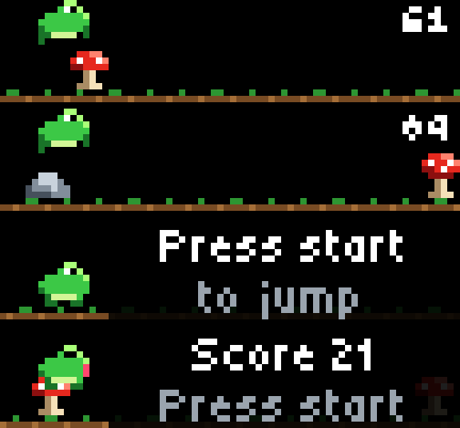

# Hop

An endless runner for the [BUSY Bar](https://busy.app). A little frog runs
along the ground, and you jump over mushrooms and rocks with the Start button.
It speeds up as you go. The app runs on the bar itself.



## Controls

| Button | What it does |
|---|---|
| Start | Jump. On the title, pause and game-over screens it starts or resumes. |
| OK (press the wheel) | Pause / resume |
| Back | Pause during a run. Exits from any other screen. |

Tall mushrooms appear from score 80, mushroom and rock pairs from 120, and bees
from 150. Bees fly at jump height, so stay on the ground while one passes. If a
notification covers the screen during a run, the game pauses. Your best score is
saved on the bar.

## Install

From the BUSY Apps Catalog once it's listed there. Or from a file: download
`io.github.maxugc.hop.tgz` from this repository's Releases, open your bar's web
page, go to **Apps**, click **+ Add app** and upload the file.

## Build

Needs Node 24 and a BUSY Bar on USB or Wi-Fi.

```sh
npm install
npm run build                                  # dist/io.github.maxugc.hop.tgz
npm run app:install -- --addr <bar address>    # leave out --addr over USB
npm run app:run -- --addr <bar address>
```

`tools/deploy.sh [bar address]` does the same without Node tooling: it packs
`src/` in the same layout and installs it through the bar's HTTP API.

- `src/main.js`: the whole game, plain JavaScript.
- `tools/make_sprites.py`: all pixel art as text grids (needs Pillow). Writes the PNGs in `src/`.
- `tools/sim.cjs`: fairness check. `npm run sim` plays 30 three-minute runs at 15 frames a
  second with a bot that searches for a way through, and reports any obstacle layout that
  can't be beaten. Run it after changing the jump, speed, hitboxes or spawning.

## Notes for BUSY Bar developers

Things found while building this on firmware 1.4.1 (HTTP API 27.15.0):

- An image can't be wider or taller than the screen (72x16), even partly off screen.
- The bar caches each image's size by file name. If you resize an image, rename it.
- `z_index` must be sent with every update of an element, or the element loses its layer.
- A draw that changes an element's type (text to image and so on) fails with "Unspecified request error".
- Images anchor top-left by default, so `align` can be left out for them.
- One draw call from an app takes about 40 ms, mostly fixed cost, so an app tops out around
  15 frames a second. Hop sends only the elements that changed each frame.
- When something with a higher priority draws over an app, the app's draws are refused (409)
  and its elements are gone afterwards. Resend everything once draws succeed again.

## License

MIT, see [LICENSE](LICENSE).
